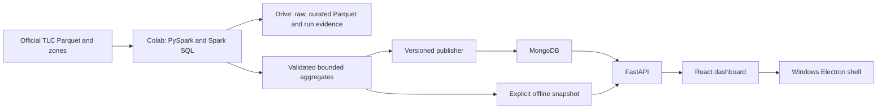

# Architecture

UrbanFlow is a modular monolith with an independent batch pipeline. The repository root is the monorepo; no nested `urbanflow/` checkout is required.

| Module | Responsibility |
|---|---|
| `pipelines/src/urbanflow_etl/ingestion` | Downloads, checksums and container validation |
| `pipelines/src/urbanflow_etl/analytics` | Eligibility, quality counts, Spark SQL and geometry conversion |
| `pipelines/src/urbanflow_etl/benchmarking` | Equivalent Pandas/Spark zone-count experiments |
| `pipelines/src/urbanflow_etl/publishing` | Immutable version publication to MongoDB |
| `apps/api/app` | Serving adapters, filters, weighted metrics and REST API |
| `apps/web/src/features` | Six modules using shared contracts and filters |
| `apps/desktop` | Sandboxed Electron renderer and managed backend lifecycle |
| `contracts` | Exported OpenAPI; TypeScript schema generated from it |
| `scripts`, `notebooks` | Environment entrypoints; reusable business logic stays in the package |

## Serving and publication

MongoDB is the default adapter. Atlas and local MongoDB use the same PyMongo implementation; local MongoDB is exercised, while hosted Atlas provisioning is external setup. Explicit `URBANFLOW_DATA_SOURCE=snapshot` selects the offline adapter and exposes `source=local_snapshot`. Database failures never trigger automatic snapshot fallback. Electron intentionally supplies the bundled snapshot.

Raw trips and complete curated data are not loaded into MongoDB. Collections are `zones`, `demand_daily`, `demand_hourly`, `trip_efficiency`, `fare_analytics`, `route_flows`, `benchmarks`, `dataset_runs` and `dataset_publications`.

The publisher claims a run ID, hashes payload bytes, upserts deterministic keys, creates run/date/zone and run/borough/date indexes, checks counts and reconciles daily trip totals. It then atomically replaces `dataset_publications/current`. Changed payloads require a new run ID. An identical failed attempt can retry; an active writer cannot be displaced. Earlier versions remain queryable. A process crash can leave a staging claim requiring explicit inspection and recovery.

FastAPI resolves one version per request. The UI pins requests to the publication so a switch does not mix chart versions. Additive sums and eligible counts preserve weighting across dates and zones. MongoDB groups hourly/efficiency summaries; the service combines bounded daily rows. Snapshot queries stream equivalent files, with lower performance than indexed MongoDB expected.

## Desktop and development

The shell starts FastAPI on a free `127.0.0.1` port, polls readiness and loads its SPA from that origin. Backend shutdown follows app shutdown. Context isolation and sandboxing are enabled; Node integration is disabled, permissions and new windows are denied, and navigation is restricted to the local origin. There is no shared database secret in the default snapshot release. A distributed hosted deployment should use a hosted API rather than embed shared Atlas credentials.

WSL supports Linux tooling and local MongoDB; Colab supplies temporary batch compute. The completed build uses the supplied Windows checkout. Drive persistence is required before stopping a runtime. Windows installers are built on Windows. Multi-user authentication is outside the personal-demo scope.
