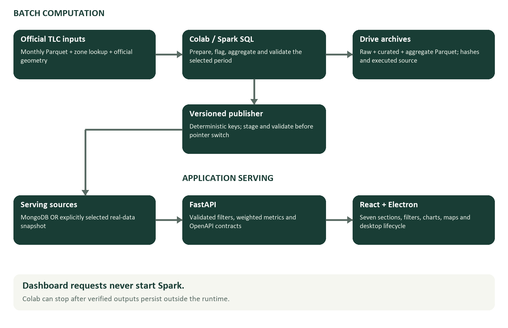
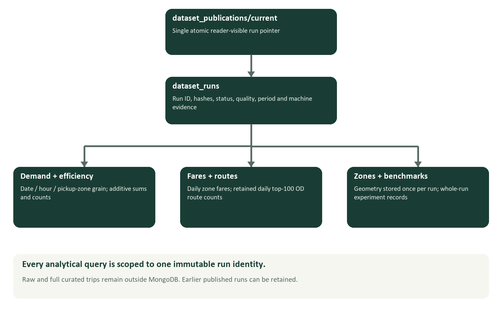
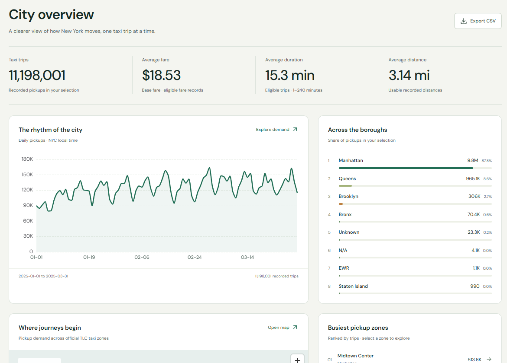
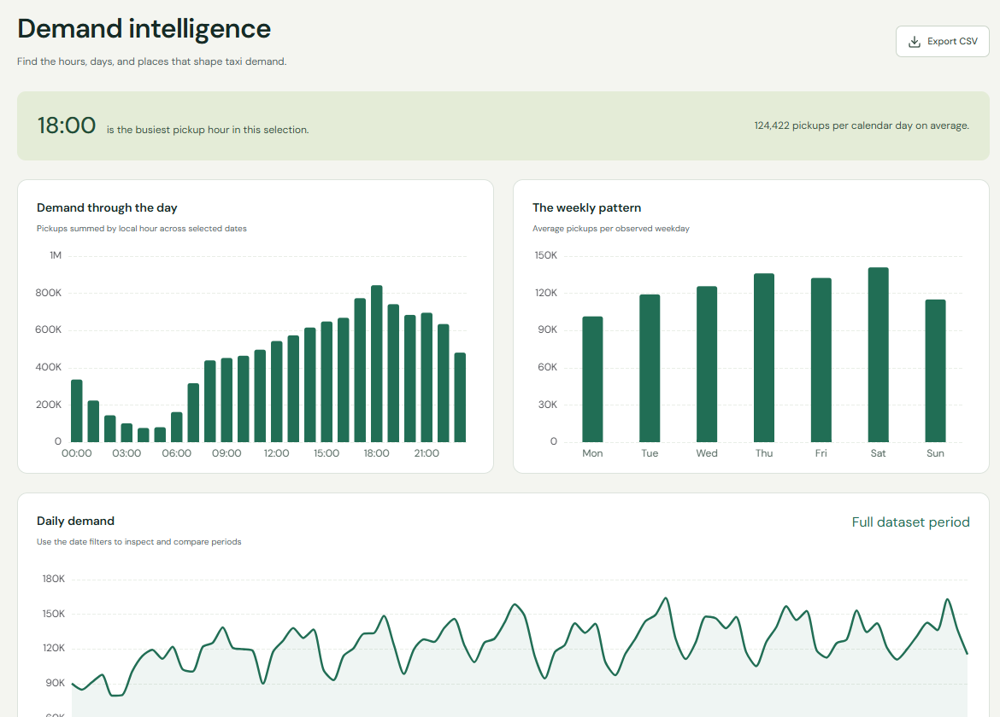
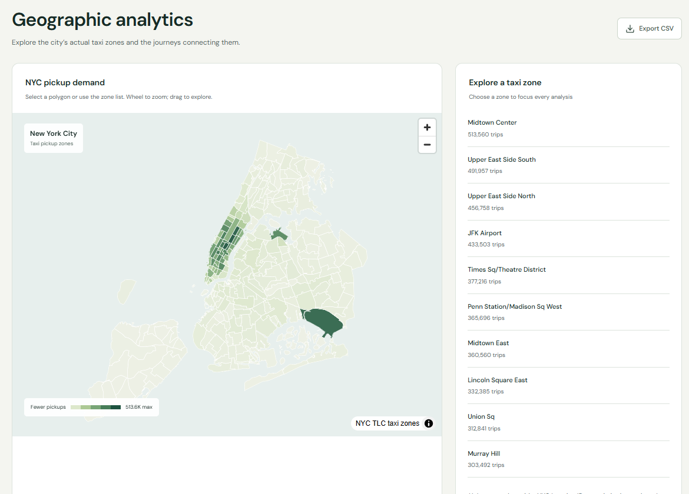
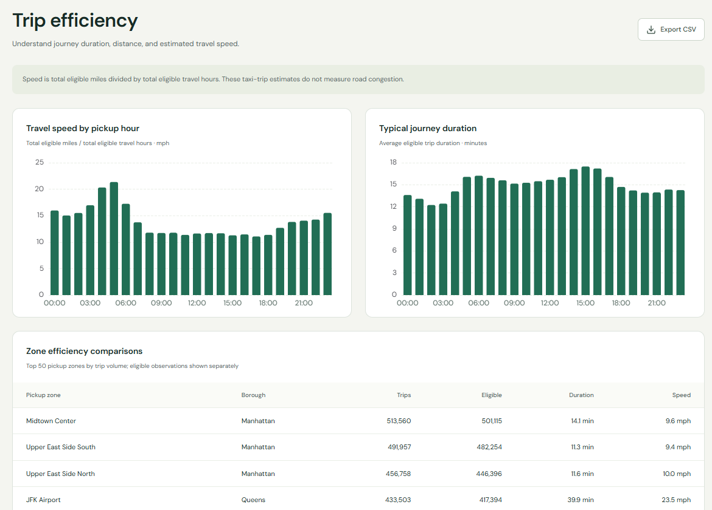
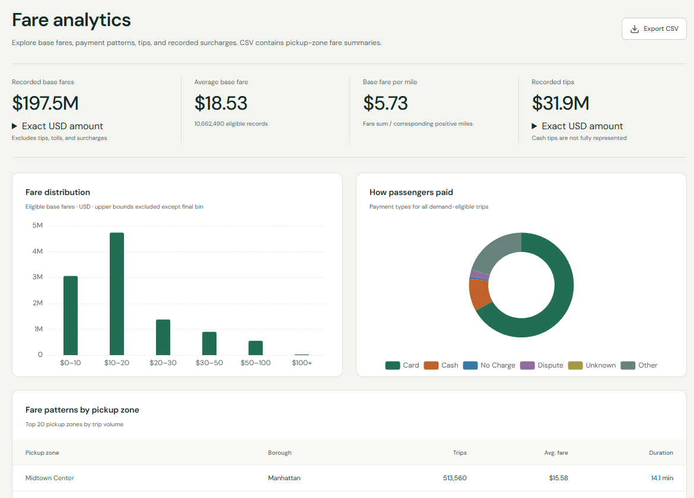
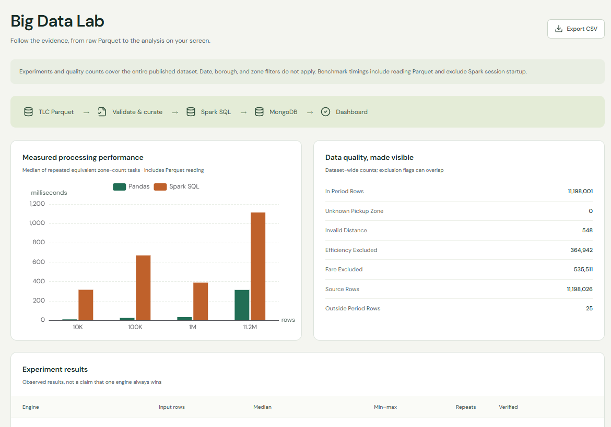
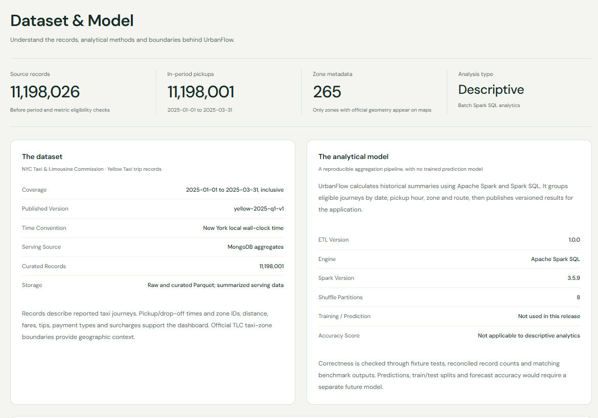
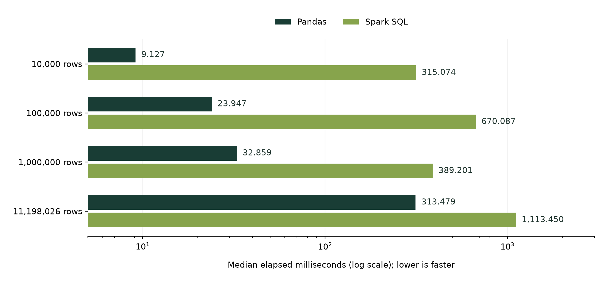

# Abstract

UrbanFlow is a reproducible urban mobility analytics application that converts official New York City Yellow Taxi trip records into an interactive, versioned dashboard and a Windows desktop application. The implemented study covers 1 January to 31 March 2025. Apache Spark and Spark SQL process 11,198,026 source records, identify 11,198,001 in-period demand-eligible journeys, and produce bounded analytical summaries. MongoDB provides the serving database, FastAPI exposes validated contracts, and React presents demand, geography, trip efficiency, fares and processing evidence. Electron packages the interface and a managed Python backend with an explicitly identified real-data snapshot.

The project separates expensive batch computation from user-facing queries. A dashboard request never starts Spark, and the completed desktop demonstration remains usable after the Colab runtime has stopped. Immutable run identities, deterministic document keys, publication-pointer switching, metric-specific eligibility flags, source hashes and persisted execution evidence make the results inspectable and repeatable. Official TLC geometries supply the map boundaries rather than approximate location markers.

The recorded Q1 analytical job completed in 259.35 seconds on a single Colab virtual machine with two CPU cores, 12.67 GiB RAM and a 4 GiB Spark driver. The experiment comparing equivalent pickup-zone counts found Pandas faster than Spark SQL at all four tested sizes on this environment. These measurements are reported without claiming distributed speedup or general superiority of either engine. Verification includes 27 passing Python tests, five frontend unit tests, real Spark fixture execution, browser checks and packaged Windows smoke tests. The report documents architectural theory, implementation, observed results, reproducibility, limitations and future extensions.

> Keywords: urban mobility; NYC TLC; batch processing; PySpark; Spark SQL; MongoDB; FastAPI; analytical dashboard; reproducibility; desktop application.

# 1. Motivation, problem and objectives

## 1.1 Why this project matters

Taxi journeys provide a concrete way to study how a city is used over time and across locations. A monthly source file contains millions of individual observations, while a human usually needs a much smaller set of answers: when pickups peak, which zones originate journeys, how fare patterns vary, and how recorded distance and duration relate. The engineering problem is therefore both computational and communicative. Large files must be processed correctly, and the resulting measurements must be presented with enough context to prevent misleading interpretation.

For a big-data academic project, a polished chart alone is insufficient evidence. The application should reveal the data source, processing volume, quality decisions and measured execution behavior. UrbanFlow consequently includes a Big Data Lab and a Dataset & Model tab alongside the conventional analytics pages. The user can inspect the provenance and analytical definitions behind the interface rather than treating a dashboard value as an unexplained answer.

The NYC TLC publishes real monthly trip records, a location lookup and taxi-zone geometry [R1, R2]. This makes the dataset useful for a reproducible project: acquisition can be specified by month, schemas can be inspected, and zone identifiers can be joined to official boundaries. It also creates real engineering challenges, including invalid measurements, missing fields, timestamp semantics and partial geographic information.

## 1.2 Problem statement

Build an application that transforms multi-million-row historical taxi data into consistent and explorable urban mobility summaries, preserves evidence of how those summaries were produced, and serves them independently of the temporary compute environment. Users must be able to filter dates, boroughs and pickup zones without waiting for a new large-scale batch job. The product should work first in a browser and subsequently as a Windows application.

## 1.3 Project objectives

- Acquire official source files with recorded URLs, byte sizes and SHA-256 digests.
- Reuse the same Python transformation modules in local tests and Colab jobs.
- Preserve demand while excluding unsuitable measurements from specific derived metrics.
- Compute daily, hourly, zone and route summaries using Spark SQL.
- Publish complete versions to MongoDB without exposing partial collection updates.
- Serve validated, filter-aware API responses and generate shared TypeScript contracts.
- Present six analytical modules plus a seventh explanatory Dataset & Model tab.
- Compare equivalent Pandas and Spark tasks with repeated measurements and equality checks.
- Package a desktop demonstration that does not require an active Colab session.
- Document uncertainty, limitations, security boundaries and reproduction steps.

## 1.4 Scope and non-goals

The implemented model is descriptive: it summarizes observed historical taxi records. There is no fitted machine-learning estimator, training split, forecasting model or prediction accuracy score. Correctness is evaluated through fixtures, reconciliations, publication invariants and equivalent experiment outputs. Future forecasting would require a separate feature design, time-based validation scheme and baseline comparison.

The project measures recorded taxi activity, not all travel in New York. It does not directly observe road congestion, vehicle occupancy across the road network, collisions, unmet demand or the causal impact of policy changes. Such questions need additional datasets and carefully defined methods. The initial system deliberately avoids streaming infrastructure, microservices and advanced ML so that the core end-to-end product remains verifiable.

# 2. Requirements and success criteria

## 2.1 Functional requirements

The system must ingest monthly Yellow Taxi Parquet files and official zone metadata; validate required columns; derive pickup date, hour and duration; produce eligible metric subsets; aggregate results; publish a version; and expose the published results through an interactive application. Global analytical filters must have consistent semantics. CSV exports must retain selected dates, zone and dataset context. Errors, empty selections and loading states must be distinguishable from successful observations of zero demand.

The map must use actual zone polygons. Selected-zone analysis must preserve geographic context without representing outside-selection polygons as measured zeros. Route displays must state that only the top 100 origin-destination routes per day were retained. Processing and experiment pages must explain whether figures describe a selection or the entire run.

## 2.2 Non-functional requirements

| Concern | Implemented response | Practical boundary |
|---|---|---|
| Responsiveness | Precomputed aggregates, indexed MongoDB queries, browser query caching | No formal concurrent-user or latency SLA was established |
| Reproducibility | Versioned source, manifests, checksums, reusable modules and archived outputs | A fresh Colab runtime may require consent and dependency installation |
| Consistency | Immutable run payloads and one atomic current-publication pointer | Hard-killed staging claims need explicit inspection |
| Portability | Browser-first UI; Windows Electron wrapper and bundled backend | Clean-machine testing remains outstanding |
| Interpretability | Units, eligibility rules, selected context and explanatory tab | Bounds are project rules, not official data guarantees |
| Security | Loopback backend, sandboxed renderer, no shared secret in default release | Public multi-user authentication is outside current scope |
| Maintainability | Monorepo with app, pipeline, contract and notebook boundaries | Broader automation can be added as operational demand grows |

## 2.3 Acceptance evidence

The Q1 source volume was processed and reconciled. The same serving payload was published to local MongoDB and used by the explicit offline adapter. The interface supports the planned analytical modules and the Dataset & Model tab. Development-machine Windows installer and portable ZIP checks validate startup, API access, rendered data, renderer restrictions and backend shutdown. Source control is hosted at the project repository [R18]. Passing these checks establishes the implemented demonstration, while it does not establish a production service, signed distribution or tested hosted Atlas deployment.

# 3. System architecture and design rationale

## 3.1 A modular monolith with an independent batch plane

UrbanFlow has one backend, one frontend and one independently executed batch-processing pipeline. This is a modular monolith at the application level. Separation follows responsibility rather than multiplying services: source ingestion and computation are isolated from request handling; repository adapters isolate storage access; frontend features share filters, components and API types.



The batch plane downloads immutable source files, computes quality flags and aggregations, and persists outputs. Google Drive stores raw Parquet, curated Parquet, serving archives and reproducibility evidence. Colab supplies temporary compute. MongoDB stores dashboard-ready summaries. FastAPI supplies a controlled serving interface; React implements presentation; Electron manages desktop lifecycle.

This separation has an important operational consequence. Restarting the frontend or opening a chart does not create a Spark session. Likewise, stopping a Colab VM does not erase the published serving database or the archived outputs. The default desktop snapshot is another explicit serving source for those same real aggregate results, rather than an automatic substitute when a database fails.

## 3.2 Why precompute instead of querying raw trips

Most dashboard questions repeat a small set of groupings: day, hour, zone and fare category. Re-reading millions of trips for every request would mix batch resource constraints with interactive behavior. Instead, the pipeline materializes sufficient sums and counts once. The backend recombines them under the selected filters, preserving correct weighting.

The design trades arbitrary ad hoc raw-trip exploration for predictable application queries and small serving payloads. New metrics may require a new batch version if their sufficient statistics were not retained. This is acceptable for a defined academic dashboard, and is made explicit in the versioned manifest rather than hidden behind the UI.

## 3.3 Repository boundaries

| Location | Responsibility |
|---|---|
| apps/web | React routes, providers, feature pages, charts, map and typed API client |
| apps/api | Configuration, serving repositories, metric services, Pydantic models and routers |
| apps/desktop | Electron main process, limited preload bridge and release configuration |
| pipelines/src/urbanflow_etl | Ingestion, Spark analytics, geometry conversion, experiments and publication |
| notebooks | Exploration and execution entrypoints importing reusable pipeline modules |
| contracts | FastAPI-exported OpenAPI specification |
| configs | Reproducible dataset selections |
| scripts | Environment setup, Colab orchestration, contract export, smoke checks and release builds |
| docs | Contracts, manifests, runbooks, validation and this illustrated report |

Some initial package directories remain reserved for future decomposition; implemented cleaning and derivation logic currently lives with the reusable analytics job. The report describes actual responsibilities rather than assuming that every proposed directory contains a separate subsystem.

# 4. Technology stack: theory, importance and implementation

## 4.1 WSL, VS Code, Git and the monorepo

WSL provides a Linux environment on the Windows development machine, which is useful for Linux tooling, the Colab CLI and local MongoDB. VS Code or a command-line editor works against the same source. The completed workspace also builds the Windows application natively, because the final Python executable and installer target Windows. Python and Node environments should belong to the operating environment executing them; mixing a Windows virtual environment with Linux binaries is not a supported workflow.

Git records source changes, contracts and compact evidence. Generated raw data, secrets, dependency directories and large release binaries are excluded. This makes review and collaboration feasible without treating Git as a data lake. A monorepo lets the OpenAPI schema, generated client, backend and UI changes be reviewed together. The remote repository is RikinParekh15147/UrbanFlow [R18].

## 4.2 Python and Apache Spark / PySpark

Python is the common implementation language for ingestion, orchestration, API logic and validation. PySpark lets the pipeline express DataFrame and SQL operations while Spark executes the data-processing plan. In theory, partitioned data can be processed by multiple execution tasks; in this run those tasks operated on one Colab VM, not a multi-machine deployment.

Spark transformations are evaluated through an execution plan, and actions such as counting, writing or materializing results trigger work. Joins, filters and aggregations form the computational graph. Narrow transformations can operate within partitions, while grouped operations can require shuffles. UrbanFlow reduces work by selecting needed columns, retaining a bounded zone lookup and persisting reused cleaned rows. The successful Q1 configuration uses DISK_ONLY for that intermediate cache to avoid exhausting a small driver heap.

PySpark is important here because the same reusable modules can process a fixture, one month or a quarter. Its value is a scalable batch programming model and explicit analytical SQL, not a promise that it will beat a dataframe library on every local task. Official Spark documentation describes the structured APIs and SQL integration [R3].

## 4.3 Spark SQL

Spark SQL supplies a declarative language for grouping, conditional sums, joins and window ranking. The program describes the required result rather than manually iterating records. UrbanFlow registers views for source, prepared and demand-eligible trips, then executes SQL groupings over date, hour and zone. Route retention uses ROW_NUMBER partitioned by date and ordered by trip count with deterministic tie-breakers.

SQL is academically important because it makes analytical definitions visible and reviewable. A reviewer can inspect exactly which predicate contributes to each metric and why a row is counted. Spark's query planner can optimize structured operations, but planning does not replace semantic validation: an efficiently executed query with the wrong denominator still produces a wrong measurement. UrbanFlow therefore keeps formulas and fixture assertions separate from performance claims.

In the general Spark SQL execution model, parsing and analysis establish a logical plan, Catalyst applies optimization rules, and a physical plan selects execution operators. Spark schedules the resulting directed acyclic graph (DAG) as stages and tasks, with shuffle boundaries separating some stages. Column pruning and predicate pushdown can reduce data read, while partial aggregation can reduce the data exchanged. These mechanisms explain the technology's role; UrbanFlow records configuration and elapsed outcomes but does not claim a separately measured contribution from each optimizer rule or provide a per-stage profiler study.

## 4.4 Apache Parquet

Parquet is a column-oriented file format designed for analytical storage [R4]. Reading only pickup-zone IDs for a benchmark can avoid loading fare and timestamp columns. Compression and encodings also reduce storage and I/O, although compressed bytes are not a reliable estimate of expanded process memory. Raw monthly files remain unchanged; analytical outputs are also written to Parquet.

Date-partitioned curated output supports inspection and later batch reuse. The recorded Q1 curated dataset contains 94 Parquet files and reconciles to 11,198,001 rows. Choosing partitions involves a tradeoff: enough partitions permit parallelism, while many tiny files add overhead. This run records eight shuffle partitions but does not establish that eight is globally optimal or that file count equals shuffle partition count.

## 4.5 Google Colab and Google Drive

Colab supplies a hosted notebook/runtime environment; its resources and lifetime are not guaranteed [R5]. UrbanFlow uses it for CPU-based Spark jobs, not as a web-serving dependency. Notebook cells mount storage, install code, supply paths and invoke reusable modules. They do not duplicate the core cleaning or aggregation algorithms.

Drive provides persistence outside the runtime. Inputs are copied to temporary Colab storage for execution, and completed artifacts are copied back and checked. This distinction matters because a ZIP that exists only under /content will disappear when the VM is recycled. The completed Q1 archive verification occurred before the runtime was stopped. Account-specific OAuth state is excluded from both the report and repository.

## 4.6 MongoDB and PyMongo

MongoDB stores BSON documents in collections. In UrbanFlow, each document represents an aggregate grain rather than an individual raw journey. PyMongo connects the publisher and API adapter to the same database model, whether hosted locally or through an Atlas URI. The verified environment uses local MongoDB; Atlas is supported by configuration but has not been provisioned or tested.

The database is important because it decouples batch output from repeated queries and supports compound indexes for the application filters. Document structure also permits a manifest to retain nested quality and machine information. A single-document write is atomic in MongoDB [R6]; UrbanFlow uses that property for its current-publication pointer after validating all staged outputs. This is an application-level version publication protocol, not a claim that every collection update occurs in one database transaction.

## 4.7 FastAPI, Pydantic, Uvicorn and OpenAPI

FastAPI exposes typed Python request handlers, Pydantic validates and serializes contracts, and Uvicorn runs the ASGI application. Date bounds, integer ranges, selection validity and response shape are controlled at the backend. The same service supports MongoDB and explicit snapshot adapters, so the frontend does not need direct storage-specific logic.

FastAPI generates an OpenAPI schema from the declared routes and models [R7]. UrbanFlow exports that schema to contracts/openapi.json and generates TypeScript definitions. openapi-fetch then uses those types for the client. This reduces manual drift between backend and frontend, although runtime integration tests remain necessary because a type declaration cannot prove a dataset is available or a metric is semantically correct.

## 4.8 React, TypeScript, Vite and React Query

React composes the interface from reusable components and feature pages [R8]. TypeScript describes props, API results and query state. Vite serves the development application and produces the browser bundle. React Router selects feature routes; lazy page loading keeps feature boundaries clear. React Query manages asynchronous server state, loading, retries and cached results.

The shared dataset provider resolves publication metadata and pins analytical requests to a run ID. It also holds shared date, borough and pickup-zone selections. This prevents a publication change between separate chart requests from silently mixing versions. Type checking improves maintainability, while server-side validation remains authoritative. The frontend never receives a MongoDB URI or reads a collection directly.

## 4.9 Tailwind CSS, shadcn-style primitives and interface design

Tailwind utilities and reusable button primitives provide a common interaction base, while application CSS defines the wider visual system. The interface uses an ivory canvas, a dark green navigation rail, lime selected states and self-hosted DM Sans. Shared panels, KPI strips, tables, spacing and formatting make different analytics pages behave as one product.

The purpose of a design system is not decoration alone. Stable units, visible selection context, clear error states and consistent hierarchy help users assess comparisons correctly. Mobile layouts replace the fixed desktop rail with a compact navigation treatment and stack content. Browser overflow checks and screenshot review were performed, but a full keyboard and computed-contrast audit remains future work.

## 4.10 Apache ECharts and MapLibre GL JS

ECharts provides interactive chart types and a rendering layer suited to data exploration [R9]. UrbanFlow uses lines, bars and other bounded series rather than rendering raw trip records. Hover and selection behavior help inspect exact values, while CSV offers an auditable alternative to reading pixels.

MapLibre GL JS renders geographic layers in the browser [R10]. UrbanFlow supplies official TLC geometry transformed to WGS84 and joins metrics by zone ID. It uses its own zone layer rather than relying on an external basemap service. Geometry is stored once per version, and missing polygons are represented as missing geography rather than invented boundaries. Color scaling and a legend communicate magnitude; dimmed context outside a selection is not a measurement of zero demand.

## 4.11 Electron, PyInstaller and electron-builder

Electron combines a Chromium renderer and a Node-enabled main process. UrbanFlow grants the renderer no Node integration, enables sandboxing and context isolation, and limits navigation and permissions. Electron's security guidance explains why isolating privileged APIs is necessary [R11]. The limited preload bridge exposes only the metadata needed by the application.

PyInstaller packages the Python backend for Windows, and electron-builder creates the installer and portable distribution. The main process starts that backend on a free loopback port, waits for readiness, opens the SPA from the local origin and stops the child when the app exits. The default release includes a verified serving snapshot, so end users do not need WSL, Python, MongoDB or Colab installed for the demonstration. Code signing and a separate clean-machine validation remain outstanding.

## 4.12 Pytest, Vitest and browser automation

Pytest verifies Python behavior, including eligibility, weighted calculations, API errors and publication invariants. Vitest verifies focused frontend logic such as date comparison normalization. Browser automation checks routes, shared filters, CSV download, empty selections and mobile overflow. These layers complement each other: unit tests isolate a rule, integration tests exercise storage boundaries, and browser checks exercise the delivered user flow.

Source lockfiles and CI checks support repeatable verification. A local Spark skip is explicitly separated from the real Spark fixture run on Colab. No benchmark, screenshot or test count is presented as proof of forecasting accuracy, universal performance or complete accessibility conformance.

# 5. Dataset, provenance and schema

## 5.1 Source selection

The primary source is NYC TLC Yellow Taxi trip records for January, February and March 2025. January was used for the initial vertical slice; Q1 extends the same path to multiple months. TLC also supplies a zone lookup CSV and shapefile archive [R1]. The Yellow Taxi data dictionary explains record field meanings, including trip timestamps, location IDs, distance, fares and payment codes [R2].

| Source artifact | Recorded bytes | Role |
|---|---:|---|
| yellow_tripdata_2025-01.parquet | 59,158,238 | January source trips |
| yellow_tripdata_2025-02.parquet | 60,343,086 | February source trips |
| yellow_tripdata_2025-03.parquet | 69,964,745 | March source trips |
| taxi_zone_lookup.csv | 12,331 | Zone IDs, names, boroughs and service labels |
| taxi_zones.zip | 1,022,574 | Official polygon geometry and projection metadata |
| Total | 190,500,974 | Five persisted raw files |

Source hashes are computed by UrbanFlow after download. They document exactly which bytes were used; they are not claimed to be vendor-supplied TLC checksums. Appendix A gives the exact URLs and digests from the completed manifest. Raw files are preserved rather than overwritten by cleaning.

## 5.2 Analytical fields

| Field | Meaning in this application | Use |
|---|---|---|
| tpep_pickup_datetime | Recorded local pickup timestamp | Period, date and hour grouping |
| tpep_dropoff_datetime | Recorded local drop-off timestamp | Duration derivation |
| PULocationID | Pickup taxi-zone identifier | Main geography and selection dimension |
| DOLocationID | Drop-off taxi-zone identifier | Origin-destination routes |
| trip_distance | Recorded trip miles | Distance and inferred speed |
| fare_amount | Base fare in USD | Fare eligibility and summaries |
| payment_type | TLC payment category code | Payment counts |
| tip_amount | Recorded tips where supplied | Nonnegative tip sums |
| total_amount | Recorded passenger total where supplied | Retained aggregate component |
| congestion_surcharge, cbd_congestion_fee | Recorded fee components where supplied | Nonnegative fee sums |

The job requires the first seven fields. Missing optional monetary columns are added as nullable doubles before analysis. This preserves a stable processing contract without pretending a missing field was observed. In sums, missing optional amounts contribute zero by explicit rule; that is a computation convention, not evidence that no charge existed.

## 5.3 Time, identity and coverage

The analytical period is inclusive: 2025-01-01 through 2025-03-31. Date and hour represent New York pickup wall-clock time, and Spark is configured for America/New_York. Source timestamps do not encode a unique UTC offset. Daylight-saving transitions consequently require caution, and repeated autumn hours would not be independently identifiable from this grouping. Q1 includes the spring transition.

No unique trip identifier is assumed, and equal source rows are not automatically deduplicated. Two similar trips do not prove duplication. The lookup contains 265 metadata entries, of which 263 have official geometry. A known lookup category such as Unknown or N/A can be retained without implying a mappable physical neighborhood. Unknown pickup lookup IDs are a different quality condition and count zero in this run.

# 6. Ingestion and reproducible storage

## 6.1 Acquisition workflow

The ingestion package reads a dataset configuration containing the selected monthly files and supporting metadata. It downloads each artifact, records elapsed time and byte size, computes SHA-256 and validates the expected container. The exact manifest accompanies downstream results. Configuration-driven acquisition avoids silently changing the period between experimental runs.

Checksums provide byte identity and corruption detection when artifacts are copied or retrieved. They do not validate fare plausibility or prove that source providers reported each trip correctly. Container checks and analytical checks therefore serve different purposes: one establishes that a file can be read, while the other establishes whether a measurement is suitable for a particular summary.

## 6.2 Storage layers

| Layer | Content | Intended lifetime |
|---|---|---|
| Raw | Original monthly Parquet and zone artifacts | Immutable reference inputs |
| Curated | In-period, prepared rows with derived fields and eligibility flags | Reusable analytical dataset |
| Aggregated Parquet | Grouped analytical tables | Reproducibility and downstream batch analysis |
| Serving JSONL | Bounded documents plus manifest | Publication and offline snapshot input |
| MongoDB | Versioned analytical documents and publication metadata | Repeated interactive queries |
| Evidence archive | Executed source, checksums, experiment records and manifests | Audit and reproduction |

The serving archive is intentionally much smaller than a raw-trip database would be. Raw and full curated trips do not enter MongoDB. This distinction is central to both performance and the educational database role: Spark handles detailed batch data; the database handles repeated application queries.

## 6.3 Completed persistence result

Q1 raw inputs and output archives were copied to Drive and checksum verified before runtime shutdown. Persistence completed at 2026-10-26T11:03:13Z. The run directory contains serving.zip (27,572,731 bytes), curated-and-aggregate-parquet.zip (322,015,163 bytes), executed-source.zip (13,547 bytes), manifest.json and benchmarks.jsonl. The full curated data reconciled to 11,198,001 rows in 94 date-partitioned files. The separate curated orchestration step imports the same reusable preparation function; it does not implement a second cleaning algorithm.

# 7. Analytical model and data-quality methodology

## 7.1 What the model means

The term model refers to a deterministic descriptive pipeline: a defined mapping from source records and eligibility rules to grouped statistics. Its parameters are explicit configuration and plausibility bounds, not learned coefficients. A new data period or ETL change produces a new run identity. Users can inspect engine, ETL version, rules, output counts and source hashes through the Dataset & Model tab.

This distinction prevents a common documentation error. A project can use large datasets and analytical algorithms without training ML. Accuracy, recall and train/test split are not suitable evaluation labels for these summaries. Instead, the meaningful questions are whether each population is defined correctly, whether sums reconcile, whether repeated publication duplicates records, and whether equivalent implementations produce the same grouped counts.

## 7.2 Preparation sequence

1. Read monthly Parquet files and validate the required analytical columns.
2. Add missing optional monetary fields as null; prune unused columns.
3. Derive pickup date, wall-clock hour, integer zone IDs and duration in minutes.
4. Join the official pickup-zone lookup and retain the requested inclusive period.
5. Calculate separate distance, efficiency and fare eligibility flags.
6. Count quality conditions before restricting demand to known pickup lookup IDs.
7. Persist prepared rows using DISK_ONLY for reuse across aggregations.
8. Compute grouped tables, export bounded documents and validate reconciliation.

## 7.3 Why eligibility differs by metric

A negative fare can indicate a refund or reversal while the pickup still describes activity. A zero-distance or implausibly long-duration record can still indicate demand, even when it should not influence speed. Discarding every row with any unsuitable field would therefore change the demand population for reasons unrelated to whether a pickup occurred.

UrbanFlow retains the in-period known-zone demand population and uses separate metric-specific numerators and denominators. Exclusion flags overlap. Adding distance, efficiency and fare exclusions would count some rows more than once and would not yield the number of distinct discarded journeys.

| Population | Implemented rule | Consequence |
|---|---|---|
| Demand | In-period pickup with a known lookup ID | Independent of fare or efficiency eligibility |
| Distance | Recorded miles from 0 to 100 inclusive | Zero distance may count in distance average |
| Efficiency | Distance >0 and <=100 miles; duration 1-240 minutes; inferred speed <=100 mph | Excludes unsuitable speed/duration measurements |
| Fare | Base fare from 0 to 1,000 USD inclusive | Negative/refund rows excluded only from fare metrics |
| Fare-per-mile | Fare eligible and distance valid with positive miles | Both numerator and denominator use the same subset |

These are project plausibility bounds. They are not official claims that every value inside the range is correct or every value outside it is fraudulent. Further sensitivity analysis could test how alternative bounds affect conclusions.

## 7.4 Recorded Q1 quality observations

| Observation | Count | Interpretation |
|---|---:|---|
| Source rows | 11,198,026 | Rows read before period restriction |
| Outside period | 25 | Excluded from this Q1 analysis |
| In-period / demand eligible | 11,198,001 | Known pickup lookup IDs after period selection |
| Unknown pickup lookup IDs | 0 | No missing pickup lookup join in-period |
| Invalid distance flags | 548 | Not distance-eligible |
| Efficiency exclusion flags | 364,942 | Not efficiency-eligible |
| Fare exclusion flags | 535,511 | Not fare-eligible |

The source-to-demand reconciliation is 11,198,026 minus 25 equals 11,198,001. Efficiency-eligible count is 10,833,059; fare-eligible count is 10,662,490. Those denominators are preserved with the aggregate sums and used by the backend. Unknown lookup IDs equal zero, while recognized metadata categories without a polygon can still be present.

# 8. Spark SQL algorithms and metric derivation

## 8.1 Sufficient statistics and weighted recombination

An aggregate stores additive components such as distance_sum and distance_count instead of only an average. If zone A has one eligible trip averaging 10 miles and zone B has nine averaging 2 miles, the correct combined mean is (10 + 18) / 10 = 2.8 miles. The unweighted average of the two means would be 6 miles and would misrepresent the observations.

The service therefore sums numerators and denominators across all selected dates and zones, then divides once. This supports consistent selection changes and prevents a frequent dashboard error. A zero denominator returns null, preserving the distinction between no usable measurement and an observed numeric zero.

| Metric | Formula | Unit |
|---|---|---|
| Trip demand | Count of demand-eligible pickups | Trips |
| Average distance | Sum(valid miles) / count(distance-eligible trips) | Miles per eligible trip |
| Average duration | Sum(eligible duration) / count(efficiency-eligible trips) | Minutes per eligible trip |
| Estimated speed | 60 x sum(efficiency miles) / sum(efficiency minutes) | Miles per hour |
| Average base fare | Sum(eligible base fare) / count(fare-eligible trips) | USD per eligible trip |
| Total base fare | Sum(eligible base fare) | USD |
| Base fare per mile | Sum(fare on joint subset) / sum(miles on joint subset) | USD per mile |

Estimated speed is a ratio of total eligible distance to total eligible travel time. It is not the arithmetic mean of per-trip speeds and does not estimate speed on individual road segments. Average distance and duration have different eligibility populations; dividing those displayed averages is not guaranteed to reproduce the speed value.

## 8.2 Representative SQL

The following abridged pattern shows the actual strategy. The complete implementation is in pipelines/src/urbanflow_etl/analytics/job.py.

```sql
SELECT date, hour, zone_id, borough,
       COUNT(*) AS trip_count,
       SUM(CASE WHEN efficiency_valid
           THEN duration_min ELSE 0 END) AS duration_sum,
       SUM(CASE WHEN efficiency_valid
           THEN trip_distance ELSE 0 END)
           AS efficiency_distance_sum,
       SUM(CASE WHEN efficiency_valid
           THEN 1 ELSE 0 END) AS efficiency_count
FROM eligible_trips
GROUP BY date, hour, zone_id, borough;
```

Conditional sums retain sufficient statistics for the intended population. Daily demand uses the same approach without hour. Fare aggregation adds bins and payment counts. At export, a count bound prevents accidentally bringing an excessively large serving output to the driver; bounded rows stream through toLocalIterator rather than collecting every raw trip.

## 8.3 Fare bins, payments and routes

Fare bins are [0,10), [10,20), [20,30), [30,50), [50,100), and [100,1000] USD over fare-eligible trips. Payment codes count all demand-eligible rows independently of fare validity. Tips and fees sum nonnegative recorded values on fare-eligible trips; cash tips are not completely observed. Total base fare is neither total passenger charges nor net operator revenue.

For routes, known destination IDs are grouped with pickup zone and date. ROW_NUMBER retains the globally top 100 per date, ordered deterministically for ties. This limits database size to 9,000 Q1 route documents. It also means a selected origin, borough or combined date range is ranked only within retained routes. The discarded tail cannot be reconstructed by the API, so those rankings are explicitly partial.

## 8.4 Complexity and memory behavior

At a conceptual level, source scanning and per-row derivation grow with input rows. Grouping adds shuffle and aggregate-state costs dependent on partitioning, key cardinality and execution behavior. Sorting route groups adds additional work. These are design explanations, not asymptotic performance measurements of this specific JVM run.

The first Q1 attempt exhausted Java heap. The completed configuration used a 4 GiB driver, selected only required columns and persisted prepared rows to disk. This experience illustrates why memory management and data width matter even when input files appear small after compression. The solution did not introduce a distributed cluster; it adapted the job to the available single-VM resources.

# 9. MongoDB data model and version publication

## 9.1 Collection grain



| Collection | Grain / content | Q1 documents |
|---|---|---:|
| demand_daily | Run x date x pickup zone | 21,549 |
| demand_hourly | Run x date x hour x pickup zone | 321,933 |
| trip_efficiency | Run x date x hour x pickup zone | 321,933 |
| fare_analytics | Run x date x pickup zone | 21,549 |
| route_flows | Run x date x retained origin-destination | 9,000 |
| zones | Run x zone ID; metadata and optional geometry | 265 |
| benchmarks | Run x experiment identity | 8 |
| dataset_runs | Manifest, hashes and publication state | Per processing run |
| dataset_publications | Current version pointer | One current document |

The daily and hourly tables contain additive metric components. Geometry is not repeated in every hour document. The apparent duplication between demand_hourly and trip_efficiency is a deliberate serving organization for separate query shapes and feature boundaries; it is not storage of raw trips.

## 9.2 Deterministic keys and indexes

Composite identities combine run and grain dimensions so rerunning an identical payload does not create duplicates. Run-scoped compound indexes align with date, zone and borough selection. API requests filter the chosen run before combining rows. Indexes consume storage, so measured document size, index size and physical collection size must be tracked separately.

At the recorded publication point, including a retained January run, the database held 908,213 documents: 343.08 MiB logical BSON data, 73.91 MiB collection storage and 33.73 MiB index storage, or 107.65 MiB total physical storage. Compression does not establish compliance with a hosted tier's logical limits. Actual Atlas storage and networking should be evaluated on the provisioned target.

## 9.3 Publication protocol

1. Read the validated manifest and serving files; bind run identity to payload hashes.
2. Claim the run so competing writers cannot silently replace the staging owner.
3. Upsert deterministic documents and create indexes under the new run ID.
4. Verify collection counts and reconcile daily trip totals against the manifest.
5. Mark the run published and replace the current-pointer document only after validation.
6. Keep previous published runs queryable for rollback or explicit inspection.

An identical published payload is a no-op on retry. A changed manifest or file payload requires a new run ID. Recoverable failed attempts can retry according to the claim rules, while a hard-killed writer can leave a staging claim requiring deliberate recovery. The current pointer is the reader-visible switch; readers do not consume a partially updated new version.

## 9.4 Explicit snapshot adapter

Snapshot mode reads the same manifest and JSONL aggregate files through an alternate repository. It is deliberately selected and reports source=local_snapshot. MongoDB failures return an error rather than silently falling back. This makes the demonstration honest: a snapshot proves real-data application delivery, while the separately verified MongoDB path proves database integration. Sequential file scanning is expected to be slower than indexed MongoDB for repeated larger queries, but no formal comparative latency result is claimed.

# 10. Backend API and contract design

## 10.1 Request flow

An analytical request resolves a published manifest, validates the filter interval and selection, queries a run-scoped repository and calculates weighted metrics. Pydantic serializes the typed response. The metadata includes run identity, selected dates, available dates, serving source, timezone and optional zone/borough. This context lets a client label the result without guessing which dataset or time convention was used.

| GET endpoint | Main responsibility |
|---|---|
| /health | Process liveness |
| /api/v1/datasets/status | Published run, serving source and full manifest |
| /api/v1/overview | KPIs, daily series, zones and boroughs |
| /api/v1/demand/daily | Daily pickup patterns |
| /api/v1/demand/hourly | Hour-of-day or date-hour demand |
| /api/v1/zones | Zone metadata with bounded pagination |
| /api/v1/zones/{id}/metrics | Pickup-zone overview |
| /api/v1/geography/heatmap | Zone GeoJSON with values and selection context |
| /api/v1/routes/top | Ranked retained origin-destination routes |
| /api/v1/trips/efficiency | Zone or hourly efficiency summaries |
| /api/v1/fares/summary | Fares, bins, payments and zone summaries |
| /api/v1/benchmarks | Whole-run experiments, quality and environment |

## 10.2 Filter semantics and errors

Relevant analytical endpoints accept start_date, end_date, borough, zone_id and run_id. Dates are inclusive and must lie entirely inside the available period, with at most 366 inclusive days. Pickup zone IDs are bounded to 1-265 and boroughs must match the lookup. Borough and zone intersect rather than replacing one another; a path zone and query zone must agree. Pagination has explicit limits and offsets where the endpoint supports it.

A valid empty selection returns empty data or zero/null summaries. A missing publication returns 503, an unavailable requested version returns 404, and invalid filter input returns 422. Errors share an error object with a code and message. Liveness alone is not a data-readiness guarantee: demonstration checks include dataset status and analytical responses.

## 10.3 Shared generated client

The backend OpenAPI export is the contract source. Generating TypeScript schema definitions prevents separate manually edited interfaces from drifting as response models evolve. Client code is typed through openapi-fetch, while query keys include selection and run identity. CI checks regenerate the artifacts and detect differences. This is contract consistency, not a substitute for runtime tests or semantic metric review.

# 11. Dashboard modules and interface walkthrough

## 11.1 City Overview

Overview is the landing screen. It combines trip count, average distance, duration and fare with a daily demand curve, borough shares, pickup-zone geography and busiest-zone rankings. Selecting a zone propagates the same filter to the other analytical pages. Units and eligibility notes are visible because the four KPI populations are not identical.



The overview supports a quick descriptive narrative: what volume the selection contains, how it varies by day, and where pickups begin. It does not claim a causal explanation for an observed peak. Busiest zones can reflect taxi access, airport activity and reporting patterns; they should not be equated with overall population movement.

## 11.2 Demand Intelligence

Demand presents daily and hour-of-day patterns and supports a comparison interval. Comparison values are normalized by calendar days, including zero-demand days, so ranges of unequal length are not compared merely through raw total volume. The same pickup-zone and borough context is retained for both periods. Missing baseline information is distinguished from a numeric improvement.



Counts describe recorded pickups. No available-vehicle denominator is included, so the chart cannot directly measure unmet demand or supply adequacy. Comparisons should account for calendar composition, holidays, seasonal changes and possible data-quality differences before interpreting them as a business trend.

## 11.3 Geographic Analytics

The map joins aggregate pickup metrics to official taxi zones. Hover details and zone selection support spatial exploration, while surrounding polygons remain contextual when a filter is active. The API's in_selection flag prevents a dimmed out-of-selection area from being described as an observed zero. Lookup-only zones are available in metadata without fabricated map boundaries.



Route connections complement zone totals, but their coverage is bounded to retained daily top-100 routes. Filtering the retained sample cannot recover a complete citywide origin-destination matrix. Spatial interpretation also depends on zone area and taxi coverage; a count-based choropleth is not population-normalized demand density.

## 11.4 Trip Efficiency

Efficiency compares duration, distance and the ratio-of-totals speed across zones and hours. Measurement eligibility is stated, and unsuitable records do not enter those denominators. The page exposes the analytical meaning of travel efficiency rather than assigning a congestion label to every slow trip.



Recorded journey duration can include circumstances other than road speed. Airport queues, meter behavior, route length and timestamp ambiguity can affect apparent speed. Without road-segment traces or an independent congestion ground truth, the output remains inferred trip-level behavior.

## 11.5 Fare Analytics

Fares presents base-fare summaries, distribution bins, payment patterns, fees and zone comparisons. Compact currency totals expand to exact values, and CSV exports name the bounded zone-summary scope. The page distinguishes base fare from total passenger payment and notes that recorded cash tips are incomplete.



Refunds and extreme base fares are excluded by the declared fare rule, but those pickups remain eligible for demand. Fare variation can reflect trip composition and regulated pricing components; the application does not infer driver profitability or policy causality from a change in averages.

## 11.6 Big Data Lab

The Lab makes processing visible. It shows source volume, quality observations, run history context, machine configuration and engine measurements. These figures describe the entire run and do not change with trip filters. The benchmark description states that Spark startup is excluded and that the task is a narrow pickup-zone count.



This page is useful in a project demonstration because it connects the visible dashboard to actual processing evidence. A reviewer can ask which inputs were used, how many records were eligible and what the experiment measured, rather than seeing only attractive charts with no computational provenance.

## 11.7 Dataset & Model

The explanatory tab presents source records, period, serving source, ETL and Spark versions, collection counts, quality rules, formulas and source artifacts. It explicitly identifies the model as descriptive batch analytics and says that training, prediction and ML accuracy are not used in this release. Dataset-wide information remains dataset-wide when trip filters are active elsewhere.



This tab gives the project an in-product methodological reference. It is generated from the run manifest where possible, so a future published version can expose its own period and counts rather than retaining a hard-coded explanation of Q1. Fixed metric rules remain documented alongside those dynamic facts.

## 11.8 Responsive behavior, exports and states

All sections share selection context and consistent loading, empty and failure states. CSV exports carry dataset identity and the current selection. This is important when a chart is later detached from the application: a saved file should still indicate what it describes. The interface was reviewed at desktop and mobile widths and checked for document overflow. Screenshots in this report are cropped from actual captures for readability; the source captures are retained with report figures.

# 12. Observed Q1 analytical results

## 12.1 Full-period metrics

The following values were retrieved from the running API for run yellow-2025-q1-v1 with the complete quarter and no borough or pickup-zone restriction. They are descriptive results produced by UrbanFlow's rules, not externally certified TLC totals. The captured JSON evidence accompanies this report.

| Measure | Observed result | Population / interpretation |
|---|---:|---|
| Trips | 11,198,001 | In-period, known pickup lookup ID |
| Average recorded distance | 3.1372 miles | Distance-eligible observations |
| Average trip duration | 15.2521 minutes | Efficiency-eligible observations |
| Estimated travel speed | 12.7154 mph | Total eligible miles / eligible hours |
| Average base fare | USD 18.5260 | Fare-eligible observations |
| Total eligible base fare | USD 197,533,432.62 | Base fare only, not net revenue |
| Efficiency-eligible trips | 10,833,059 | Separate duration/speed denominator |
| Fare-eligible trips | 10,662,490 | Separate fare denominator |

The source-to-demand retention is extremely high because only 25 rows lie outside the selected period and no in-period pickup IDs fail the lookup. This should not be misread as a statement that almost every measurement is analytically valid: the separate fare and efficiency exclusions are materially larger.

## 12.2 Spatial observations

| Pickup zone | Q1 trips | Interpretation |
|---|---:|---|
| Midtown Center, zone 161 | 513,560 | Highest pickup count in the returned ranking |
| Upper East Side South, zone 237 | 491,957 | Second-highest pickup count |
| Upper East Side North, zone 236 | 456,758 | Third-highest pickup count |

Manhattan accounts for 9,827,095 recorded pickups in this selection, followed by Queens with 965,052 and Brooklyn with 306,011. These are taxi pickup counts and should not be generalized to all-mode travel shares. Airport and service patterns may make taxi observations geographically selective. Zone names and counts are useful descriptive findings, while explaining why those patterns exist requires additional evidence.

## 12.3 Processing and output result

The recorded analytics phase took 259.348 seconds. Its timer covers the implemented analytical job, not all source acquisition, benchmark execution, full curated export, Drive upload and packaging. The analytics job produced six serving collections; the experiment step added the seventh collection, benchmarks, containing eight documents. Count reconciliation and archived evidence establish that results persisted beyond the temporary runtime.

The two most important engineering outcomes are that millions of raw observations are reduced to bounded, versioned query inputs, and that the delivered application can explore them without an active Spark process. These are supported by actual publication and desktop checks; no unmeasured latency or concurrent-user capacity is assigned.

# 13. Performance experiment and analysis

## 13.1 Experimental question

For an equivalent Parquet-read-and-pickup-zone-count task on the same Colab machine, how do Pandas and Spark SQL elapsed times compare as input row count increases? This is narrower than comparing the complete UrbanFlow ETL. The task is chosen because both engines can produce the same bounded mapping from zone ID to count, allowing exact correctness checks.

## 13.2 Controlled protocol

Spark materializes identical bounded samples containing only PULocationID. Each sample is coalesced to one Parquet file. Four sizes are used: 10,000; 100,000; 1,000,000; and the complete 11,198,026 source rows. Each engine runs three repetitions. Order alternates to reduce a consistent first-reader advantage. Null zone IDs are normalized consistently, and each result dictionary and total count must match.

The timer includes reading the sample and result materialization. It excludes creating the sample and starting the Spark session. OS caches are not cleared; samples use limit rather than random sampling. Full input at the largest size occupies only 12,337,418 compressed bytes because it has one column. This protocol is therefore favorable to a local dataframe approach and does not stress multi-node scale or wide-table memory.

| Environment item | Recorded value |
|---|---|
| Runtime | Single Colab Linux VM |
| CPU cores | 2 |
| Available RAM | 12.67 GiB |
| Python | 3.13.16 |
| Spark | 3.5.9 |
| Pandas | 2.2.3 |
| Spark shuffle partitions | 8 |
| Spark driver heap | 4 GiB for completed Q1 analysis |

## 13.3 Measured medians

| Input rows | Pandas median ms | Spark SQL median ms | Faster in this experiment |
|---:|---:|---:|---|
| 10,000 | 9.127 | 315.074 | Pandas |
| 100,000 | 23.947 | 670.087 | Pandas |
| 1,000,000 | 32.859 | 389.201 | Pandas |
| 11,198,026 | 313.479 | 1,113.450 | Pandas |



Pandas was faster at every tested size on this VM. That result is consistent with overhead mattering when the task and data width are small enough for local execution, but this explanation is an interpretation rather than a measured decomposition of scheduler, I/O and compute costs. Spark's value in the project is its batch model and reusable aggregation pipeline, not an unsupported speedup claim.

## 13.4 Threats to validity

Three repetitions support a median but do not characterize broad machine variability. Cache state, warm-up, temporary filesystem behavior and shared runtime load can affect results. The 100,000-row Spark median exceeding the one-million-row median illustrates that these data should not be fitted as a smooth scaling law. All raw samples, minimum and maximum are retained in experiment records.

The experiment does not establish distributed scaling, full-ETL speedup, multi-user query performance, partition optimality or a universal Pandas-versus-Spark ranking. A stronger follow-up would use wider inputs, controlled repeated environments, explicit cold/warm runs, larger-than-memory datasets and independently varied partition counts, while preserving identical computations and exact equality checks.

# 14. Testing, verification and evidence

## 14.1 Layered verification strategy

Correctness is checked at several boundaries. Small analytical fixtures verify rule behavior and expected aggregates. API tests verify filter semantics, null handling, metadata and errors. Publication tests verify identity, staging failure behavior, deterministic writes and pointer consistency. Real MongoDB integration verifies that the database adapter participates in the serving path. Browser checks cover integrated navigation and interaction. Desktop checks cover the packaged child-process lifecycle and restricted renderer.

| Check | Recorded outcome | Scope |
|---|---|---|
| Python tests | 27 passed; one Spark-only module skipped locally | Backend and pipeline local suite |
| Spark fixture | Passed separately in Colab | Real Spark analytical correctness |
| Frontend unit tests | 5 passed | Focused frontend logic |
| TypeScript and build | Passed | Static checks and production assets |
| Python lint / formatting | Passed | Code quality checks |
| Generated contracts | Refreshed together | OpenAPI / TypeScript consistency |
| Production npm audit | Zero vulnerabilities at recorded check | Dependency audit snapshot |
| Browser interaction | Routes, filters, empty selection, CSV, mobile overflow passed | Integrated UI flow |
| Screenshot review | Six analytical sections reviewed with ship disposition | Visual quality, not full accessibility |
| Packaged backend | Twelve route checks passed | Windows executable serving path |
| Installer and portable ZIP | Startup, API, data, restrictions and shutdown passed | Development Windows machine |

The Dataset & Model tab was added after the initial six-section release verification. The Windows release was subsequently rebuilt and its verification record refreshed at 2026-10-26T17:57:55Z, with installed and portable checks completed for the updated application. The report includes that refreshed release evidence. Exact artifact hashes should be read from the evidence rather than assuming that an older installer contains the new tab.

## 14.2 Invariants worth testing

Daily trip totals must match the demand population in the manifest. Date and zone filters must preserve the requested run. A zero eligible denominator must remain null. A failed publication must not change the current version. Identical publication must not duplicate documents. Changed bytes under an immutable run ID must be rejected. MongoDB failure must not silently turn into snapshot mode. Outside-selection map polygons must remain context instead of being reported as zero-demand observations.

These properties are more meaningful than tests that merely restate a function implementation. They correspond to user-visible and data-integrity failures that would change the interpretation of results.

## 14.3 What has not been established

A dependency audit result is time-specific. Screenshot review does not certify keyboard accessibility or contrast ratios. The new orchestration notebooks have valid JSON and compilable cells but were not independently run end to end. Their underlying modules produced the recorded Q1 run. Atlas connectivity, code signing and a fresh Windows machine without the development environment remain unverified. The report preserves these distinctions instead of treating all checks as one undifferentiated pass.

# 15. Windows delivery, security and operations

## 15.1 Desktop lifecycle

On launch, Electron obtains a free 127.0.0.1 port, starts the packaged backend with web and snapshot paths, waits for readiness and loads the application from that loopback origin. It stores diagnostic logs under the user's UrbanFlow application-data directory. It uses a single-instance lock and focuses an existing window on a second launch. On exit, it shuts down the managed backend rather than leaving an orphan service.

The installer and portable ZIP both passed the recorded development-machine checks. The portable ZIP is an extracted application folder, not a separate analytics engine. Offline here means the verified aggregate snapshot is bundled; it does not imply that fetching new TLC data or publishing to Atlas works without a network.

## 15.2 Security boundaries

The renderer has Node integration disabled, context isolation enabled and sandboxing enabled. New windows and arbitrary permission requests are denied. Navigation is restricted to the local application origin, and the preload bridge exposes limited metadata instead of general filesystem or shell access. The backend binds to loopback. These measures reduce the attack surface associated with embedding web content in a desktop runtime [R11].

No shared MongoDB credential is shipped in the default snapshot release. For wider distribution with a shared live database, a hosted authenticated API is preferable to embedding common database secrets in desktop binaries. A local personal demo and a public multi-user service have different threat models; the latter needs explicit authentication, authorization, rate limiting and deployment hardening.

## 15.3 Operational recovery

If the dashboard has no publication, inspect dataset status and the configured source rather than launching a Spark job on demand. In MongoDB mode, verify URI, server availability and publication state. In snapshot mode, verify manifest and collection files. If the app fails to start, inspect backend.log and ensure the build contains web assets and serving data. Configuration is read at process startup, so environment changes require a restart.

For a failed publisher, inspect staging ownership and payload identity before retry or cleanup. Retain earlier published versions until rollback is no longer needed. For Colab interruption, retrieve only completed verified outputs and restart the reproducible job if required. Always verify Drive persistence before stopping a temporary runtime.

# 16. Build methodology and reproducibility guide

## 16.1 Development sequence

The implementation followed a vertical-slice approach: one source month through ingestion, Spark, publication, API and chart; then the same structure expanded to Q1 and additional features. This exposes integration errors early. The batch pipeline was stabilized before desktop packaging, keeping operating-system lifecycle problems separate from metric correctness.

The completed project combines modular Python functions, generated contracts and feature-based React pages. Notebooks are orchestration entrypoints. Windows packaging uses native tooling and a verified snapshot. This sequence is a practical method for managing complexity in an academic project without introducing unnecessary distributed infrastructure.

## 16.2 Browser reproduction

The following commands are illustrative repository-root PowerShell commands. A fresh checkout needs the verified serving archive or regenerated outputs, because generated data is excluded from Git. Use the actual uv command available in the environment.

```powershell
uv sync --python 3.12
npm ci
$env:URBANFLOW_DATA_SOURCE = 'snapshot'
$env:URBANFLOW_SNAPSHOT_DIR = 'data/serving'
uv run uvicorn app.main:app --host 127.0.0.1 --port 8000
# Separate terminal:
npm run dev
```

For MongoDB demonstration, publish data/serving using the reusable publishing module, set URBANFLOW_DATA_SOURCE=mongodb and provide a valid MongoDB URI. Do not place credentials in frontend environment variables or commit them. The bundled snapshot path is a demonstration mode; the repository runbook provides the database path separately.

## 16.3 Batch reproduction

Install the pipeline extras for Spark, geometry and benchmarking in a Java-compatible environment. Download using configs/yellow-2025-q1.json. Supply all three monthly Parquet files, the zone CSV and geometry archive, a fresh run ID, inclusive period and partition count to the analytics module. Set the driver heap before starting Spark.

```bash
pip install -e 'pipelines[spark,geometry,benchmark,publish]'
export PYSPARK_SUBMIT_ARGS='--driver-memory 4g pyspark-shell'
python -m urbanflow_etl.ingestion.download \
  --config configs/yellow-2025-q1.json --output data/raw
python -m urbanflow_etl.analytics.job \
  --input data/raw/yellow_tripdata_2025-01.parquet \
          data/raw/yellow_tripdata_2025-02.parquet \
          data/raw/yellow_tripdata_2025-03.parquet \
  --zones data/raw/taxi_zone_lookup.csv \
  --geometry data/raw/taxi_zones.zip \
  --output data/results --start 2025-01-01 \
  --end 2025-03-31 --run-id yellow-2025-q1-reproduction \
  --partitions 8
```

The separate benchmark module runs equivalent engine counts and updates the serving manifest. The curated export script writes full prepared data. Colab-specific wrappers supply /content paths and Drive persistence; they import these reusable functions. Exact archived executed source is retained with the completed run, while current notebooks document a fresh execution entrypoint.

## 16.4 Validation and release commands

```powershell
uv run pytest
uv run ruff check .
npm run check
npm test
npm run build
uv run python scripts/export-openapi.py
npm run generate:api
powershell -File scripts/build-release.ps1
```

Spark tests require a real Spark environment. Record the actual command outcome rather than assuming that a skipped test passed. A fresh checkout without local MongoDB and Spark reports optional integration skips; the recorded 27-test result explicitly includes the configured real MongoDB checks. Release hashes identify exact artifacts and should be refreshed after any frontend or backend rebuild.

# 17. Limitations, ethics and validity

## 17.1 Representativeness and interpretation

Yellow Taxi trips describe a particular transport service and its reporting coverage. They do not measure every resident, journey or mode. Zone-level counts can be strongly shaped by airport travel, service availability and reporting conventions. A spatial concentration of taxi pickups is not a universal indicator of mobility demand or infrastructure need. The project avoids person-level tracking and does not infer individual identities from aggregated results.

## 17.2 Measurement uncertainty

Timestamps are local wall-clock values with DST ambiguity. Distance and monetary fields can contain reporting errors. Plausibility thresholds reduce some unsuitable measurements but do not establish ground truth. Cash tips are incompletely represented. Recognized zone metadata can lack polygons. Partial daily route retention limits later route ranking. Base fares exclude other passenger charges and are not net revenue.

The interface should preserve these distinctions in exports and explanations. If the dataset or ETL rules change, a new run identity and revised manifest are required. Comparing versions with different rules without accounting for those changes could create an artificial trend.

## 17.3 Engineering and experimental limits

Spark ran on one VM, so the project does not demonstrate a distributed cluster's speedup. The benchmark used a narrow single-column input and three repeats without cleared OS caches. No formal load test, public authentication layer, production uptime target or query-latency SLA was established. Snapshot delivery proves independent application operation but does not substitute for hosted database verification.

The Windows release is unsigned and was tested on the development machine. Atlas deployment and clean-machine installation remain follow-ups. The generated notebooks have not been independently executed end to end. These limits identify where additional evidence is needed; they do not invalidate the observed Q1 processing and application behavior.

# 18. Future work and extension roadmap

## 18.1 Release hardening

The next practical work is a clean Windows installation test, code signing and a complete keyboard/contrast audit. Provision and test Atlas only when a hosted serving target is needed. Validate networking, permissions and actual logical storage before choosing a hosted tier. Keep the default installer free of shared database credentials.

## 18.2 Analytical extensions

Add more 2025 months using the same versioned path. Evaluate eligibility thresholds through sensitivity analysis. Improve temporal comparisons for weekday composition and holiday context. If complete route analytics is required, redesign retained OD granularity and storage rather than presenting the current top-100 sample as exhaustive. Additional mobility or collision datasets can support separate, explicitly named analyses.

## 18.3 Stronger performance research

Run controlled cold/warm experiments across wider data, multiple machines or cluster configurations. Vary partition settings independently, retain resource measurements and use enough repetitions to report uncertainty. Compare full ETL only when both implementations perform equivalent cleaning, joins and outputs. Never equate a narrow count microbenchmark with the complete application's speedup.

## 18.4 Optional forecasting

A future forecasting model could use historical pickup counts with calendar and weather features. It would require time-ordered splits, leakage prevention, naive seasonal baselines, explicit horizons and metrics such as MAE or RMSE. Geographic transfer and drift would need evaluation. Such a model would be a new module with its own evidence, rather than a relabeling of the current descriptive aggregation pipeline.

# 19. Conclusion

UrbanFlow completes a substantial real-data analytics path: official monthly acquisition, reusable Spark SQL preparation, metric-specific eligibility, bounded versioned summaries, local MongoDB publication, validated API contracts, an interactive dashboard and a managed Windows desktop demonstration. The completed quarter contains 11,198,026 source records, with 11,198,001 pickups in the declared demand population. Archived inputs, source hashes and execution evidence make the central result inspectable.

The main contribution is the separation of computation from serving combined with transparent measurement definitions. The project shows how a large detailed dataset can become a usable application without requiring Spark for every user interaction. Its experiments also show why big-data tools should be evaluated honestly: Pandas outperformed Spark on the measured narrow count task, while Spark still supplied the reusable batch pipeline. Future work should strengthen deployment and experimental validation before broadening claims or adding prediction.

# References

References were consulted on 26 October 2026. Official documentation supports technology descriptions; repository manifests and verification records support project-specific measurements. Version ranges in current package manifests and exact lockfiles govern reproduction. A documentation site's current release should not be confused with the recorded Spark 3.5.9 runtime.

[R1] NYC Taxi and Limousine Commission. TLC Trip Record Data. https://www.nyc.gov/site/tlc/about/tlc-trip-record-data.page

[R2] NYC Taxi and Limousine Commission. Data Dictionary - Yellow Taxi Trip Records, March 2025. https://www.nyc.gov/assets/tlc/downloads/pdf/data_dictionary_trip_records_yellow.pdf

[R3] Apache Spark. Spark SQL, DataFrames and Datasets Guide, 3.5 series. https://spark.apache.org/docs/3.5.7/sql-programming-guide.html

[R4] Apache Parquet. Format overview. https://parquet.apache.org/docs/overview/

[R5] Google Research. Colaboratory frequently asked questions. https://research.google.com/colaboratory/faq.html

[R6] MongoDB. Atomicity and Transactions. https://www.mongodb.com/docs/manual/core/write-operations-atomicity/

[R7] FastAPI. Features and OpenAPI-based contracts. https://fastapi.tiangolo.com/features/

[R8] React. Describing the UI. https://react.dev/learn/describing-the-ui

[R9] Apache ECharts. Features. https://echarts.apache.org/en/feature.html

[R10] MapLibre. MapLibre GL JS documentation. https://maplibre.org/maplibre-gl-js/docs/

[R11] Electron. Security and process sandboxing. https://www.electronjs.org/docs/latest/tutorial/security and https://www.electronjs.org/docs/latest/tutorial/sandbox

[R12] UrbanFlow repository evidence. docs/q1-run.json: processing manifest, collection counts, quality flags, runtime and source digests.

[R13] UrbanFlow repository evidence. docs/q1-drive-export.json: completed persistence and copied artifact hashes.

[R14] UrbanFlow repository evidence. docs/validation.md and docs/release-verification.json: tests, installed/portable checks and stated validation limits.

[R15] UrbanFlow source. pipelines/src/urbanflow_etl/analytics/job.py and benchmarking/job.py: actual SQL, eligibility and benchmark protocol.

[R16] UrbanFlow source. apps/api/app/services/analytics.py, repositories/analytics.py and contracts/openapi.json: formulas, adapters and API schema.

[R17] UrbanFlow source. apps/desktop/main/index.cjs and docs/desktop-release.md: managed backend and renderer policy.

[R18] UrbanFlow source repository. https://github.com/RikinParekh15147/UrbanFlow

[R19] UrbanFlow report evidence. docs/report/evidence/overview.json and benchmarks.jsonl: API result capture and repeated experiment records used in this report.

# Appendix A. Source identity and archive checksums

The following identities come from the completed Q1 manifest. They identify exact artifacts used in the run; source files may be revised upstream, so a future download should be compared rather than assumed identical.

## A.1 January source

URL: https://d37ci6vzurychx.cloudfront.net/trip-data/yellow_tripdata_2025-01.parquet

SHA-256: 9af277e4c0d3f9deb30644da822981e1e7df6af58313170fd3aa8a474485488a

## A.2 February source

URL: https://d37ci6vzurychx.cloudfront.net/trip-data/yellow_tripdata_2025-02.parquet

SHA-256: 037cba555a73663f3a51a2c27816e40e3feb364769942bdf122b9da31e377bd3

## A.3 March source

URL: https://d37ci6vzurychx.cloudfront.net/trip-data/yellow_tripdata_2025-03.parquet

SHA-256: 20c4b77cce457b7cfdae77c5069ca7dc91c167f876a41467f4502ab69487a186

## A.4 Zone metadata and geometry

Lookup URL: https://d37ci6vzurychx.cloudfront.net/misc/taxi_zone_lookup.csv

Lookup SHA-256: 1a99e105092230f8620f301edcca7f80d3080642ff404d28ed957d3fa222c8ed

Geometry URL: https://d37ci6vzurychx.cloudfront.net/misc/taxi_zones.zip

Geometry SHA-256: f6d711917bb4340f8f644d5366c51665489eb2d426dd1a4a55677721ae5adf17

## A.5 Persisted output archives

Serving ZIP SHA-256: 95a1bb3d5d220d17afaf0b30268c36321d651ee1d4ba768951017a674879646b

Curated and aggregate Parquet ZIP SHA-256: 0a52f9dccceb83d15ca733e2ca58bd49f78204ebd91074943665d7d27907dca8

Executed source ZIP SHA-256: b9aeb8ea22e05f9b3d776c90dd3d4ac256fc6bb86f5da5f2554e8005d5b95aae

The persisted manifest and benchmark JSON digests are recorded in q1-drive-export.json. The report's copied evidence is a readable audit package; the large source and output datasets remain outside Git.

# Appendix B. Glossary and demonstration checklist

| Term | Meaning in UrbanFlow |
|---|---|
| Aggregate grain | The dimensions defining one summary document |
| Batch processing | A bounded job over historical input, separate from interactive requests |
| BSON | MongoDB's document representation |
| Choropleth | Areas colored by a selected zone-level measurement |
| Curated data | Prepared records with derived fields and quality flags |
| Eligibility | The population rule determining whether a record contributes to a metric |
| ETL | Extract, transform and load; here acquisition, preparation and publication |
| Manifest | Run identity, period, quality, environment and output evidence |
| Publication pointer | The single current-version document switched after validation |
| Ratio of totals | Summed numerator divided by summed denominator |
| Run ID | Immutable identity tying inputs, rules and outputs together |
| Serving snapshot | Explicit offline adapter over real bounded aggregate files |
| Shuffle | Redistribution of grouped data across Spark execution partitions |
| Wall-clock time | Local displayed time without a uniquely supplied UTC offset |

## Suggested demonstration sequence

1. Open Dataset & Model and identify period, run ID, data source and descriptive method.
2. Show Overview and explain the different eligibility populations behind averages.
3. Select a pickup zone and confirm the same selection persists across analytical pages.
4. Compare demand intervals and explain calendar-day normalization.
5. Explore official polygons and distinguish context outside the selection.
6. Explain ratio-of-totals speed and base fare versus passenger charges.
7. Export a CSV and verify selection and dataset provenance.
8. Open the Lab, report the measured Pandas advantage honestly and explain the task scope.
9. Show that Colab is stopped while the desktop still operates.
10. State whether the active source is MongoDB or the real-data snapshot, and name the remaining release-validation limits.
